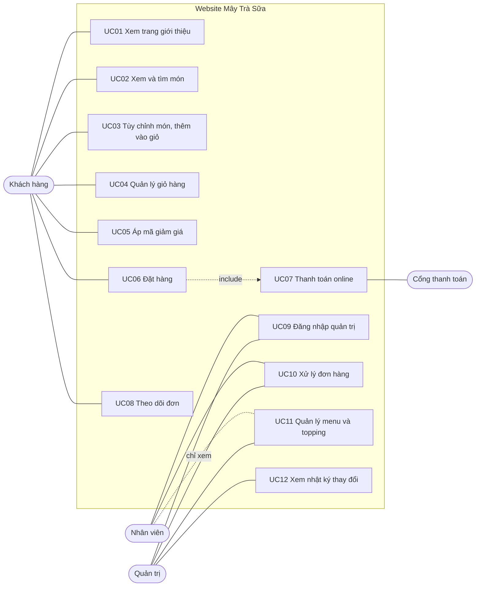
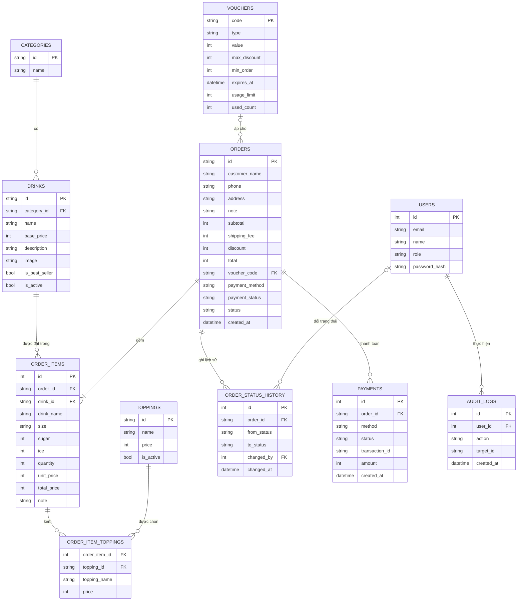
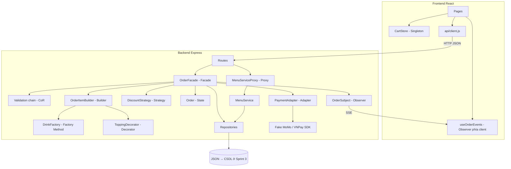
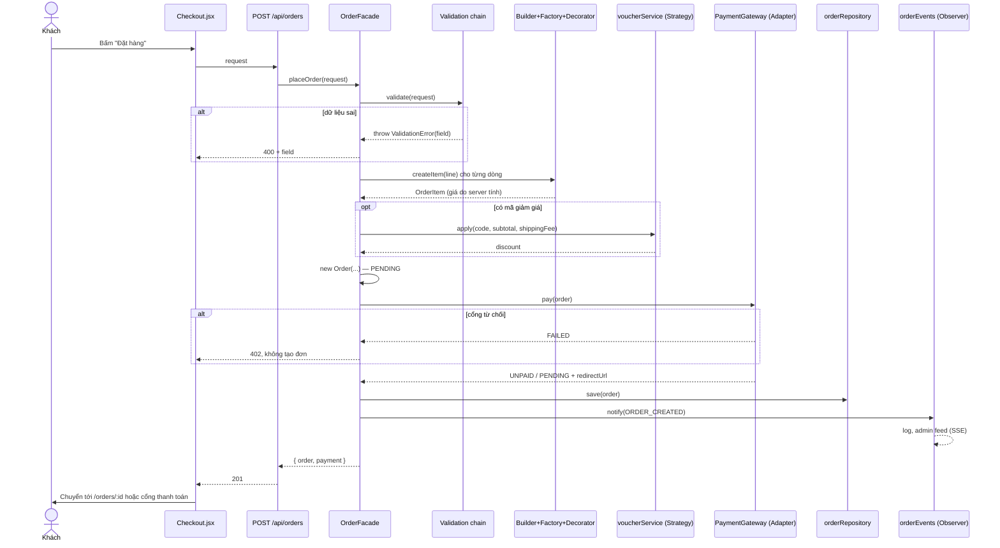
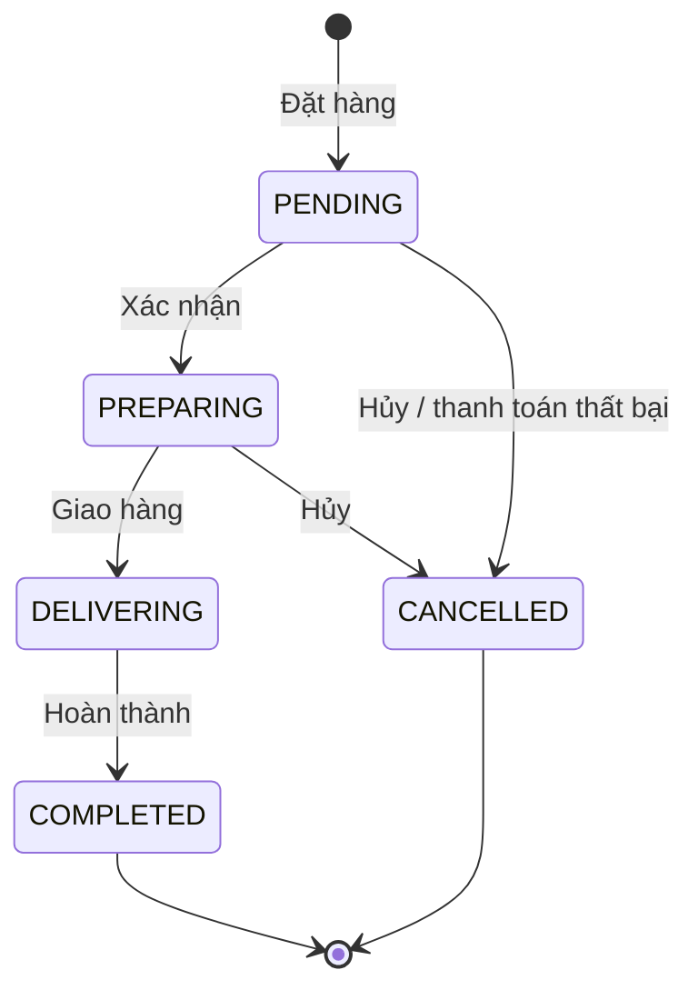

# Đặc tả yêu cầu phần mềm — Website Mây Trà Sữa

> Phiên bản 1.0 · 10/10/2026 · Nhóm 5 người · Môn Mẫu thiết kế
> Tài liệu liên quan: `KE_HOACH.md` (tiến độ), `API.md` (hợp đồng API), `PHAN_CONG_SPRINT_*.md` (phân công)

---

## 1. Giới thiệu

### 1.1 Mục đích
Mô tả đầy đủ chức năng, quy tắc nghiệp vụ, dữ liệu và kiến trúc của website đặt trà sữa. Tài liệu dùng để: chia việc, làm căn cứ viết test, nghiệm thu, và đưa vào báo cáo cuối kỳ.

### 1.2 Phạm vi

**Trong phạm vi**
- Landing page giới thiệu thương hiệu, món bán chạy, khuyến mãi.
- Xem menu, tìm kiếm, lọc theo danh mục.
- Tùy chỉnh món (size, đường, đá, topping), giỏ hàng, mã giảm giá.
- Đặt hàng không cần tài khoản, thanh toán COD hoặc qua cổng **giả lập** MoMo/VNPay.
- Theo dõi trạng thái đơn theo thời gian thực.
- Trang quản trị: đăng nhập, xử lý đơn, quản lý món/topping, nhật ký thay đổi.
- Áp dụng **11 mẫu thiết kế GoF** thuộc cả 3 nhóm (mục 7).

**Ngoài phạm vi**
- Thanh toán thật, đăng ký/đăng nhập cho khách, tích điểm thành viên.
- Định vị shipper, bản đồ thời gian thực, nhiều chi nhánh.
- Gửi SMS/email thật (chỉ mô phỏng bằng thông báo trong trang).

### 1.3 Thuật ngữ

| Thuật ngữ | Nghĩa |
|---|---|
| Món / đồ uống | Một sản phẩm trong menu, ví dụ "Trà sữa truyền thống" |
| Dòng món | Một món đã tùy chỉnh trong giỏ hoặc đơn (size, đường, đá, topping, số lượng) |
| Tạm tính | Tổng tiền các dòng món, chưa gồm phí ship và giảm giá |
| SSE | Server-Sent Events: server đẩy sự kiện xuống trình duyệt qua một kết nối HTTP mở sẵn |
| Cổng giả | Trang `/payment/mock` mô phỏng màn hình MoMo/VNPay để demo |
| BRxx | Mã quy tắc nghiệp vụ trong mục 4 |

---

## 2. Tổng quan hệ thống

### 2.1 Tác nhân

| Tác nhân | Mô tả | Đăng nhập |
|---|---|---|
| **Khách hàng** | Người mua, xem menu và đặt đơn | Không |
| **Nhân viên** (`staff`) | Nhận và xử lý đơn, xem menu | Có |
| **Quản trị** (`admin`) | Mọi quyền của nhân viên, cộng thêm sửa menu và xem nhật ký | Có |
| **Cổng thanh toán** | Hệ thống ngoài (giả lập) báo kết quả thanh toán | — |

### 2.2 Sơ đồ use case

### 2.3 Danh sách use case

| Mã | Tên | Tác nhân | Pattern liên quan | Sprint | Phụ trách |
|---|---|---|---|---|---|
| UC01 | Xem trang giới thiệu | Khách | — | 0, 1 | TV2 |
| UC02 | Xem và tìm món | Khách | Factory Method | 0, 1 | TV1 |
| UC03 | Tùy chỉnh món, thêm vào giỏ | Khách | Builder, Decorator, Singleton | 1 | TV3, TV2 |
| UC04 | Quản lý giỏ hàng | Khách | Singleton | 1 | TV1, TV2 |
| UC05 | Áp mã giảm giá | Khách | Strategy | 1 | TV4 |
| UC06 | Đặt hàng | Khách | Facade, Chain of Responsibility | 2 | TV1, TV5 |
| UC07 | Thanh toán online | Khách, Cổng | Adapter | 2 | TV3 |
| UC08 | Theo dõi đơn | Khách | State, Observer | 1, 2 | TV5, TV2 |
| UC09 | Đăng nhập quản trị | Nhân viên, Quản trị | — | 2 | TV4 |
| UC10 | Xử lý đơn hàng | Nhân viên, Quản trị | State, Observer | 2 | TV5, TV2 |
| UC11 | Quản lý menu và topping | Quản trị (Nhân viên chỉ xem) | Proxy | 2 | TV4 |
| UC12 | Xem nhật ký thay đổi | Quản trị | Proxy | 2 | TV4 |

---

## 3. Đặc tả use case

### UC01 — Xem trang giới thiệu
- **Luồng chính:** khách mở `/` → thấy hero, nút "Đặt ngay", món bán chạy (lấy từ API), lý do chọn quán, mã khuyến mãi, giờ mở cửa, đánh giá khách hàng.
- **Ngoại lệ:** API lỗi → mục món bán chạy hiện thông báo lỗi, các mục tĩnh vẫn hiển thị.

### UC02 — Xem và tìm món
- **Luồng chính:** khách mở `/menu` → chọn tab danh mục hoặc gõ từ khóa → danh sách lọc ngay.
- **Quy tắc:** chỉ hiện món đang bán (BR23); tìm kiếm không phân biệt hoa thường.
- **Ngoại lệ:** không có kết quả → "Không tìm thấy món phù hợp".

### UC03 — Tùy chỉnh món và thêm vào giỏ
- **Tiền điều kiện:** món đang bán.
- **Luồng chính:**
  1. Khách mở `/menu/:id`, hệ thống hiện thông tin món và lựa chọn mặc định (BR03).
  2. Khách đổi size, mức đường, mức đá, chọn topping, số lượng, ghi chú.
  3. Mỗi lần đổi, hệ thống tính lại giá (BR02) qua `POST /api/cart/price` và hiển thị.
  4. Khách bấm "Thêm vào giỏ" → dòng món được thêm/gộp vào giỏ (BR05), số trên biểu tượng giỏ tăng.
- **Ngoại lệ:** lựa chọn không hợp lệ → API trả 400, giữ nguyên lựa chọn cũ và báo lỗi.
- **Pattern:** Builder dựng dòng món; Decorator cộng topping; Singleton giữ giỏ duy nhất.

### UC04 — Quản lý giỏ hàng
- **Luồng chính:** khách mở `/cart` → tăng/giảm số lượng, xóa dòng → tạm tính cập nhật ngay; giỏ còn nguyên khi tải lại trang (BR05).
- **Ngoại lệ:** giỏ trống → lời nhắc và nút về Menu; nút "Tiến hành đặt hàng" bị ẩn.

### UC05 — Áp mã giảm giá
- **Luồng chính:** khách nhập mã ở giỏ → `POST /api/vouchers/validate` → hiện số tiền giảm, tổng mới (BR07–BR09).
- **Ngoại lệ:** mã không tồn tại (404), hết hạn, hết lượt, chưa đủ đơn tối thiểu (400) → thông báo cụ thể; tổng giữ nguyên.
- **Quy tắc:** mỗi đơn tối đa một mã; đổi mã thì mã cũ bị thay.
- **Pattern:** Strategy (mỗi loại mã một cách tính).

### UC06 — Đặt hàng
- **Tiền điều kiện:** giỏ có ít nhất một dòng.
- **Luồng chính:**
  1. Khách mở `/checkout`, nhập họ tên, SĐT, địa chỉ, ghi chú, chọn phương thức thanh toán.
  2. Bấm "Đặt hàng" → frontend gửi **một** request `POST /api/orders`.
  3. Hệ thống kiểm tra dữ liệu theo chuỗi BR10 → BR14, dừng ở lỗi đầu tiên.
  4. Hệ thống dựng lại từng dòng món từ dữ liệu gốc. Giá do server tính, không tin giá gửi từ trình duyệt (BR02).
  5. Áp mã giảm giá nếu có (BR07–BR09), cộng phí ship (BR06).
  6. Tạo đơn trạng thái `PENDING`, gọi cổng thanh toán (UC07 nếu chọn online).
  7. Lưu đơn, phát sự kiện `ORDER_CREATED` (màn hình admin nhận ngay).
  8. Trả kết quả: COD → chuyển tới `/orders/:id`; online → chuyển tới cổng thanh toán.
- **Ngoại lệ:**
  - 3a. Dữ liệu sai → 400 kèm `field`, trang hiện lỗi dưới đúng ô, giỏ giữ nguyên.
  - 5a. Mã giảm giá không còn hợp lệ → 400/404, không tạo đơn.
  - 6a. Cổng từ chối tạo giao dịch → 402, **không tạo đơn** (BR18).
- **Hậu điều kiện:** đơn được lưu, giỏ được xóa ở trình duyệt.
- **Pattern:** Facade (`OrderFacade.placeOrder`), Chain of Responsibility (bước 3), Builder + Factory + Decorator (bước 4), Strategy (bước 5), State + Adapter (bước 6), Observer (bước 7). Sơ đồ tuần tự ở mục 7.3.

### UC07 — Thanh toán online
- **Luồng chính:**
  1. Sau UC06 bước 8, khách được chuyển tới `/payment/mock?gateway=momo|vnpay&...`.
  2. Trang cổng giả hiện mã đơn, số tiền, hai nút "Thanh toán thành công" / "Hủy giao dịch".
  3. Khách chọn → trang gửi kết quả tới `POST /api/payments/confirm`.
  4. Hệ thống xác minh chữ ký qua Adapter của cổng tương ứng, cập nhật trạng thái thanh toán (BR17), phát sự kiện `PAYMENT_UPDATED`.
  5. Khách được chuyển về `/orders/:id`.
- **Ngoại lệ:** chữ ký sai → 400, đơn không đổi; khách hủy → đơn `CANCELLED`, thanh toán `FAILED`.
- **Pattern:** Adapter (MoMo và VNPay có giao diện SDK khác nhau, Adapter đưa về một interface `PaymentGateway`).

### UC08 — Theo dõi đơn
- **Luồng chính:** khách mở `/orders/:id` → thấy thanh tiến trình 4 bước, trạng thái thanh toán, chi tiết đơn. Khi nhân viên đổi trạng thái, trang **tự cập nhật** không cần tải lại và hiện thông báo nổi.
- **Ngoại lệ:** mã đơn không tồn tại → 404 "Không tìm thấy đơn"; đơn đã hủy → nhãn "Đã hủy".
- **Pattern:** State (vòng đời đơn), Observer (đẩy sự kiện qua SSE).

### UC09 — Đăng nhập quản trị
- **Luồng chính:** mở `/admin/login`, nhập email + mật khẩu → nhận token, chuyển tới `/admin/orders`.
- **Ngoại lệ:** sai thông tin → "Email hoặc mật khẩu không đúng" (BR21); hết phiên → quay về trang đăng nhập.

### UC10 — Xử lý đơn hàng
- **Tiền điều kiện:** đăng nhập với vai trò `staff` hoặc `admin`.
- **Luồng chính:**
  1. Mở `/admin/orders` → bảng đơn mới nhất trước, lọc theo trạng thái.
  2. Đơn mới tự xuất hiện kèm thông báo nổi (Observer).
  3. Bấm nút theo trạng thái hiện tại: "Xác nhận" (PENDING → PREPARING), "Giao hàng" (→ DELIVERING), "Hoàn thành" (→ COMPLETED), "Hủy" (BR15).
  4. Hệ thống đổi trạng thái, ghi lịch sử, phát `STATUS_CHANGED` → trang khách tự cập nhật.
- **Ngoại lệ:** thao tác không hợp lệ với trạng thái hiện tại → 409, bảng tải lại trạng thái mới nhất.

### UC11 — Quản lý menu và topping
- **Luồng chính (admin):** mở `/admin/menu` → xem bảng món → thêm/sửa (tên, danh mục, giá, mô tả, ảnh, bán chạy) → "Ngừng bán" thay cho xóa (BR23). Topping làm tương tự.
- **Luồng phụ (nhân viên):** xem được bảng; thao tác sửa bị từ chối 403 "Bạn không có quyền thực hiện thao tác này" (BR20).
- **Ngoại lệ:** dữ liệu sai → 400 (BR19).
- **Pattern:** Proxy (`MenuServiceProxy` kiểm tra quyền và ghi nhật ký trước/sau khi gọi `MenuService` thật).

### UC12 — Xem nhật ký thay đổi
- **Luồng chính (admin):** tab "Nhật ký" → danh sách thời điểm, người làm, hành động, đối tượng (BR22). Nhân viên không thấy tab này.

---

## 4. Quy tắc nghiệp vụ

| Mã | Quy tắc |
|---|---|
| **BR01** | Mọi số tiền là **số nguyên VND**, chỉ định dạng "35.000đ" khi hiển thị. |
| **BR02** | Đơn giá dòng món = giá gốc + phụ thu size (M: 0đ, L: +6.000đ) + tổng giá topping. Thành tiền = đơn giá × số lượng. **Giá luôn do server tính.** |
| **BR03** | Size ∈ {M, L}; mức đường, mức đá ∈ {0, 30, 50, 70, 100}%. Mặc định: M, 100%, 100%, số lượng 1. |
| **BR04** | Có thể chọn nhiều topping; chọn cùng topping nhiều lần thì cộng giá nhiều lần. |
| **BR05** | Giỏ gộp các dòng có **cùng món và cùng mọi tùy chọn** (cộng số lượng). Giỏ lưu ở trình duyệt, còn khi tải lại trang. |
| **BR06** | Phí giao hàng cố định **15.000đ** mỗi đơn (`config.shippingFee`). |
| **BR07** | Mã giảm giá hợp lệ khi: tồn tại, chưa hết hạn, tạm tính ≥ `minOrder`, còn lượt dùng (nếu có `usageLimit`). Mỗi đơn tối đa **một** mã. |
| **BR08** | Cách tính: `percent` giảm % tạm tính, làm tròn xuống, không quá `maxDiscount`; `fixed` giảm số tiền cố định; `freeship` giảm bằng phí ship. Số tiền giảm không âm và không vượt tạm tính + phí ship. |
| **BR09** | Tổng thanh toán = tạm tính + phí ship − giảm giá. |
| **BR10** | Đơn phải có ít nhất 1 dòng món. |
| **BR11** | Họ tên ≥ 2 ký tự; SĐT Việt Nam khớp `^(0\|\+84)(3\|5\|7\|8\|9)\d{8}$`; địa chỉ ≥ 10 ký tự (sau khi bỏ khoảng trắng hai đầu). |
| **BR12** | Phương thức thanh toán ∈ {COD, MOMO, VNPAY}. |
| **BR13** | Mọi món và topping trong đơn phải đang bán; số lượng mỗi dòng là số nguyên 1–20. |
| **BR14** | Chỉ nhận đơn từ **08:00 đến trước 22:00** giờ Việt Nam. |
| **BR15** | Vòng đời đơn: `PENDING → PREPARING → DELIVERING → COMPLETED`. Chỉ hủy được khi `PENDING` hoặc `PREPARING`. Đơn `COMPLETED`/`CANCELLED` không đổi được nữa. Mỗi lần đổi ghi lịch sử (từ, sang, thời điểm). |
| **BR16** | Trạng thái thanh toán: COD → `UNPAID` khi tạo đơn; online → `PENDING` khi tạo đơn, chờ cổng báo về. |
| **BR17** | Cổng báo thành công → `PAID`. Cổng báo thất bại hoặc khách hủy → `FAILED` và đơn tự chuyển `CANCELLED`. Chữ ký sai → bỏ qua, trả 400. |
| **BR18** | Nếu cổng từ chối tạo giao dịch ngay lúc đặt (sai số tiền...) thì **không tạo đơn**, trả 402. |
| **BR19** | Món/topping: tên không rỗng, giá là số nguyên ≥ 0, danh mục phải tồn tại. |
| **BR20** | Phân quyền: khách không cần tài khoản; `staff` xem menu + xử lý đơn; `admin` toàn quyền. |
| **BR21** | Phiên đăng nhập hết hạn sau 8 giờ. Đăng nhập sai không cho biết sai email hay sai mật khẩu. Mật khẩu chỉ lưu dạng băm (scrypt). |
| **BR22** | Mọi thao tác **sửa** menu ghi nhật ký: thời điểm, email, hành động, mã đối tượng. Thao tác xem không ghi. |
| **BR23** | Không xóa hẳn món/topping, chỉ "Ngừng bán" (`isActive = false`). Món ngừng bán không hiện ở menu khách và không đặt được; đơn cũ vẫn giữ tên và giá tại thời điểm đặt. |

---

## 5. Màn hình

| Màn hình | Đường dẫn | Thành phần chính | Trạng thái cần xử lý | Phụ trách |
|---|---|---|---|---|
| Landing | `/` | Hero, món bán chạy, lý do chọn, khuyến mãi, đánh giá, giờ mở cửa | Đang tải, lỗi API | TV2 |
| Menu | `/menu` | Tab danh mục, ô tìm kiếm, lưới thẻ món | Đang tải, rỗng, lỗi | Sprint 0 |
| Chi tiết món | `/menu/:id` | Ảnh, mô tả, form tùy chỉnh, giá trực tiếp, "Thêm vào giỏ" | 404 món, lỗi tính giá | TV3 |
| Giỏ hàng | `/cart` | Danh sách dòng, +/−, xóa, ô mã giảm giá, tạm tính | Giỏ trống, lỗi mã | TV1, TV4 |
| Đặt hàng | `/checkout` | Form giao hàng, chọn thanh toán, tóm tắt, "Đặt hàng" | Lỗi theo ô, đang gửi, lỗi 402 | TV1, TV3 |
| Cổng giả | `/payment/mock` | Thông tin giao dịch, 2 nút kết quả | Tham số thiếu, chữ ký sai | TV3 |
| Theo dõi đơn | `/orders/:id` | Thanh tiến trình, thanh toán, chi tiết, toast | 404, đã hủy, mất kết nối SSE | TV5, TV2 |
| Đăng nhập admin | `/admin/login` | Email, mật khẩu | Sai thông tin, đang gửi | TV4 |
| Quản lý đơn | `/admin/orders` | Tab trạng thái, bảng đơn, nút thao tác, chi tiết | Rỗng, 409, đơn mới (toast) | TV5, TV2 |
| Quản lý menu | `/admin/menu` | Bảng món/topping, form, "Ngừng bán", nhật ký | 403 với nhân viên, lỗi dữ liệu | TV4 |

**Yêu cầu chung:** chạy tốt từ độ rộng 360px; mọi nút có chữ rõ nghĩa; thông báo lỗi tiếng Việt, nói rõ cách sửa.

---

## 6. Mô hình dữ liệu

Sprint 1–2 lưu bằng JSON/bộ nhớ qua các repository; Sprint 3 chuyển sang CSDL quan hệ theo sơ đồ dưới, không phải sửa tầng trên.

**Ghi chú:** `ORDER_ITEMS.drink_name`, `unit_price` và `ORDER_ITEM_TOPPINGS.topping_name`, `price` là **bản chụp** tại thời điểm đặt (BR23). Đổi giá menu sau đó không làm sai đơn cũ.

---

## 7. Kiến trúc và mẫu thiết kế

### 7.1 Kiến trúc tầng

### 7.2 Bảng mẫu thiết kế

| Nhóm | Pattern | Vấn đề giải quyết | Lớp chính | Sprint | Phụ trách |
|---|---|---|---|---|---|
| Creational | Factory Method | Mỗi loại đồ uống có quy tắc riêng, route không nên tự `new` | `DrinkCreator` + 4 ConcreteCreator | 1 | TV1 |
| Creational | Singleton | Mọi trang phải dùng chung một giỏ | `CartStore` | 1 | TV2 |
| Creational | Builder | Dòng món nhiều tùy chọn, có mặc định | `OrderItemBuilder` | 1 | TV3 |
| Structural | Decorator | Tổ hợp topping không giới hạn | `ToppingDecorator` | 0 | Mẫu |
| Structural | Facade | Đặt đơn đi qua 7 hệ thống con | `OrderFacade` | 2 | TV1 |
| Structural | Adapter | Mỗi cổng thanh toán một kiểu SDK | `MomoAdapter`, `VnPayAdapter`, `CodAdapter` | 2 | TV3 |
| Structural | Proxy | Phân quyền + nhật ký cho thao tác sửa menu | `MenuServiceProxy` | 2 | TV4 |
| Behavioral | Strategy | Nhiều kiểu khuyến mãi, đổi lúc chạy | `DiscountStrategy` + 3 lớp con | 1 | TV4 |
| Behavioral | State | Mỗi trạng thái đơn cho phép thao tác khác nhau | `OrderState` + 5 lớp con | 1 | TV5 |
| Behavioral | Observer | Nhiều nơi cần biết khi đơn thay đổi | `OrderSubject` + 3 observer | 2 | TV2 |
| Behavioral | Chain of Responsibility | Nhiều điều kiện kiểm tra độc lập, dễ thêm bớt | 5 `…Handler` | 2 | TV5 |

### 7.3 Sơ đồ tuần tự — Đặt hàng (UC06)

### 7.4 Sơ đồ trạng thái đơn (BR15, BR17)

---

## 8. Giao diện lập trình (API)

Chi tiết request/response ở `API.md`. Tóm tắt:

| Nhóm | Endpoint |
|---|---|
| Menu (công khai) | `GET /api/categories`, `/drinks`, `/drinks/:id`, `/toppings`, `/options` |
| Giỏ & mã | `POST /api/cart/price`, `POST /api/vouchers/validate` |
| Đơn hàng | `POST /api/orders`, `GET /api/orders/:id`, `PATCH /api/orders/:id/status`, `GET /api/orders/:id/events` (SSE) |
| Thanh toán | `GET /api/payments/methods`, `POST /api/payments/confirm` |
| Quản trị | `POST /api/admin/login`, `/logout`, `GET /me`, CRUD `/api/admin/drinks`, `/toppings`, `GET /api/admin/audit-log`, `GET /api/admin/orders`, `PATCH /api/admin/orders/:id/status`, `GET /api/admin/events` (SSE) |

---

## 9. Yêu cầu phi chức năng

| Loại | Yêu cầu |
|---|---|
| Hiệu năng | Trang chủ tải xong dưới 3 giây trên mạng 4G; API trả về dưới 300ms khi chạy máy cá nhân. |
| Bảo mật | Mật khẩu băm scrypt; token ngẫu nhiên 32 byte, hết hạn 8 giờ; mọi route `/api/admin` kiểm tra quyền; kiểm tra dữ liệu ở **cả** frontend và backend; giá luôn tính lại ở server. |
| Khả dụng | Mobile-first từ 360px; không có thanh cuộn ngang; thông báo lỗi tiếng Việt nói rõ cách sửa; nút và ô nhập có nhãn. |
| Bảo trì | Mỗi file pattern có khối chú thích GoF; mỗi pattern có test đơn vị; mỗi route mới có test API; quy ước code theo `QUY_UOC.md`. |
| Tương thích | Chrome, Edge, Firefox, Safari bản mới; Node.js 20 trở lên. |
| Kiểm thử | `npm test` không có FAIL trước mỗi lần merge; cuối dự án không còn test `todo`. |

---

## 10. Tiêu chí nghiệm thu

Dự án được coi là hoàn thành khi chạy được trọn các kịch bản sau trên bản `main`:

1. Khách chọn món → tùy chỉnh size L, đường 50%, thêm 2 topping → giá đúng BR02.
2. Thêm 2 lần cùng tổ hợp → giỏ gộp một dòng số lượng 2 (BR05), tải lại trang giỏ vẫn còn.
3. Áp `MAY10` cho đơn 100.000đ → giảm 10.000đ; áp mã hết hạn → báo lỗi rõ ràng.
4. Đặt hàng COD → đơn `PENDING`/`UNPAID`; màn hình admin hiện đơn mới không cần tải lại.
5. Nhân viên xác nhận → trang khách tự chuyển "Đang pha chế"; thử hủy đơn đang giao → bị từ chối.
6. Đặt MoMo → thanh toán thành công → `PAID`. Đặt VNPay → hủy → đơn `CANCELLED`.
7. Nhập SĐT sai → lỗi hiện đúng ô; đặt lúc 23:00 (đổi giờ giả lập) → báo cửa hàng đóng cửa.
8. Nhân viên sửa giá món → 403; admin sửa được, nhật ký ghi lại.
9. `npm test` toàn bộ PASS, không còn test `todo`; mỗi pattern có `docs/patterns/<ten>.md`.
