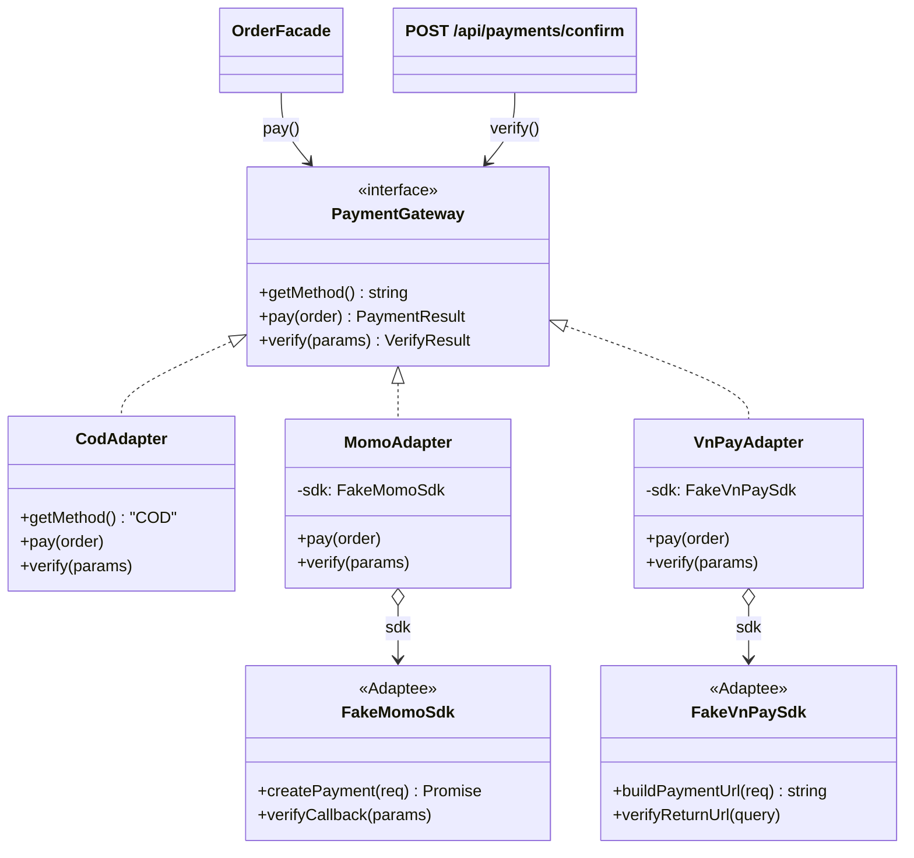

# Adapter — Một cửa cho mọi cổng thanh toán

**Nhóm:** Structural · **Phụ trách:** TV3 · **File:** `server/src/patterns/structural/PaymentAdapter.js` · **Test:** `server/tests/adapter.test.js`, `server/tests/payment.test.js`

## Vấn đề

Cửa hàng nhận 3 cách trả tiền, mỗi cách "nói một ngôn ngữ" khác nhau (hai SDK giả trong `server/src/integrations/` mô phỏng đúng sự khác biệt của cổng thật):

| | MoMo (`FakeMomoSdk`) | VNPay (`FakeVnPaySdk`) | COD |
|---|---|---|---|
| Tạo giao dịch | `await createPayment({ partnerCode, orderId, amount })` (async) | `buildPaymentUrl({ vnp_TxnRef, vnp_Amount })` (đồng bộ) | không có SDK |
| Số tiền | VND | **VND × 100** | — |
| Báo lỗi | trả `resultCode` khác 0 | **ném lỗi** (`throw`) | — |
| Kết quả trả về | `resultCode` số: `0` / `1006` | `vnp_ResponseCode` chuỗi: `'00'` / `'24'` | — |
| Mã đơn trong callback | `orderId` | `vnp_TxnRef` | — |

Nếu `OrderFacade` và route xác nhận thanh toán gọi thẳng từng SDK, code sẽ đầy `if (method === 'MOMO') ... else if (method === 'VNPAY') ...`, phải nhớ nhân 100 chỗ này, bắt `try/catch` chỗ kia. Thêm ZaloPay là phải sửa Facade và route.

## Giải pháp

Định nghĩa một interface chung **`PaymentGateway`** (Target) với 3 hàm mà phía dùng cần: `getMethod()`, `pay(order)`, `verify(params)`. Mỗi cổng có một **Adapter** giữ SDK bên trong (Adaptee) và "dịch" qua lại:

- `pay()` luôn trả `PaymentResult = { method, status, redirectUrl, message }` và **không bao giờ ném lỗi vì cổng**: `MomoAdapter` đổi `resultCode ≠ 0` thành `FAILED`, `VnPayAdapter` bắt `throw` của SDK thành `FAILED` và tự nhân 100 số tiền.
- `verify()` luôn trả `{ orderId, success, transactionId }`, chữ ký sai thì `HttpError(400)`.
- `CodAdapter` không bọc SDK nào nhưng vẫn cài cùng interface (`UNPAID`, không chuyển trang), nên Facade xử lý COD giống hệt cổng online.

`createPaymentGateway(method)` chọn adapter theo mã phương thức. Facade và route chỉ thấy `PaymentGateway`.

## Sơ đồ lớp



| Vai trò GoF | Lớp trong dự án |
|---|---|
| Target | `PaymentGateway` |
| Adaptee | `FakeMomoSdk`, `FakeVnPaySdk` (thư viện "bên thứ ba", không sửa) |
| Adapter | `MomoAdapter`, `VnPayAdapter`, `CodAdapter` |
| Client | `OrderFacade.placeOrder()` (gọi `pay`), route `POST /api/payments/confirm` (gọi `verify`) |

Đây là **Object Adapter**: adapter *chứa* SDK (`this.sdk`) thay vì kế thừa SDK, nên test có thể truyền SDK giả khác vào constructor.

## Adapter dịch những gì

| Hợp đồng chung | `MomoAdapter` | `VnPayAdapter` |
|---|---|---|
| `pay(order)` | `createPayment({ partnerCode, orderId: order.id, amount: order.total })` | `buildPaymentUrl({ vnp_TxnRef: order.id, vnp_Amount: order.total * 100 })` |
| thành công | `resultCode === 0` → `PENDING` + `payUrl` | không ném lỗi → `PENDING` + URL |
| thất bại | `resultCode ≠ 0` → `FAILED` + `message` | `catch (err)` → `FAILED` + `err.message` |
| `verify(params).orderId` | `orderId` | `vnp_TxnRef` |
| `verify(params).success` | `Number(resultCode) === 0` | `vnp_ResponseCode === '00'` |
| `verify(params).transactionId` | `transId` | `vnp_TransactionNo` |

## Vì sao không chỉ viết một hàm `pay(method, order)` có `switch`?

Hàm `switch` vẫn chạy, nhưng mọi cổng nằm chung một chỗ: sửa cách gọi VNPay có thể làm hỏng MoMo, và hàm phình theo số cổng. Với Adapter, mỗi cổng là một lớp riêng, test riêng; thêm ZaloPay = viết `ZaloPayAdapter` + một dòng trong `ADAPTER_BY_METHOD` + thêm `'ZALOPAY'` vào `config.paymentMethods`. Facade, route và giao diện (`PaymentMethodPicker` lấy danh sách từ API) không phải sửa.

## Ví dụ

```js
const gateway = createPaymentGateway('VNPAY');
await gateway.pay({ id: 'DH004', total: 47000 });
// { method: 'VNPAY', status: 'PENDING', message: 'Thành công',
//   redirectUrl: '/payment/mock?gateway=vnpay&vnp_Amount=4700000&...&vnp_SecureHash=...' }

await createPaymentGateway('MOMO').pay({ id: 'DH005', total: 500 });
// { method: 'MOMO', status: 'FAILED', redirectUrl: null,
//   message: 'MoMo từ chối giao dịch: Số tiền giao dịch không hợp lệ (1.000đ – 50.000.000đ)' }

await gateway.verify({ ...queryCổngGửiVề, vnp_ResponseCode: '24' });
// { orderId: 'DH004', success: false, transactionId: null }
```

## Nơi dùng trong dự án

- `OrderFacade.placeOrder()` bước 5: `paymentGatewayFactory(method).pay(order)`; `FAILED` → 402, không tạo đơn (BR18).
- `POST /api/payments/confirm` (`server/src/routes/payment.routes.js`): `verify()` → cập nhật `paymentStatus` (BR17), khách hủy thì đơn `CANCELLED`.
- `GET /api/payments/methods` → `client/src/components/PaymentMethodPicker.jsx` trên trang Đặt hàng.
- Trang cổng giả `client/src/pages/PaymentMock.jsx` đọc tham số riêng của từng cổng (VNPay chia 100 để hiện số tiền) và gửi kết quả về server.
