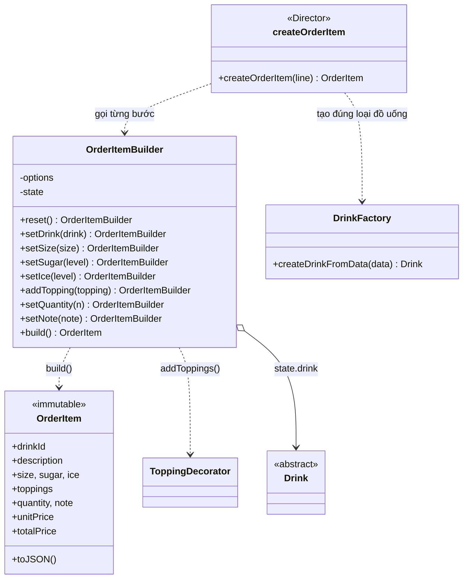
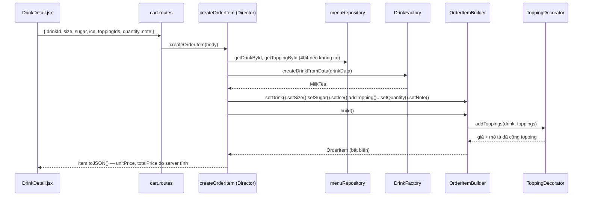

# Builder — Dựng dòng món nhiều tùy chọn

**Nhóm:** Creational · **Phụ trách:** TV3 · **File:** `server/src/patterns/creational/OrderItemBuilder.js`, `server/src/services/orderItemService.js` · **Test:** `server/tests/builder.test.js`, `server/tests/cart.test.js`

## Vấn đề

Một dòng món trong giỏ có 7 thuộc tính: đồ uống, size, mức đường, mức đá, danh sách topping, số lượng, ghi chú. Phần lớn có giá trị mặc định (M, 100%, 100%, 1 ly, BR03), topping thì có thể không có hoặc có nhiều.

Nếu tạo bằng constructor:

```js
new OrderItem(drink, 'L', 50, 70, [pearl, pudding], 2, 'ít ngọt'); // 50 là đường hay đá?
new OrderItem(drink, undefined, undefined, 70, [], 1, '');         // chỉ muốn đổi đá
```

Lời gọi khó đọc, dễ truyền nhầm thứ tự (đường và đá cùng kiểu số), mỗi nơi tạo món lại phải tự nhớ giá trị mặc định, tự kiểm tra hợp lệ và tự tính giá.

## Giải pháp

`OrderItemBuilder` dựng món **từng bước**, mỗi bước một hàm có tên rõ nghĩa và trả về chính builder để nối chuỗi:

- `reset()` nạp giá trị mặc định từ `options.json`, nên bước nào không gọi thì dùng mặc định.
- Mỗi hàm `set...()` kiểm tra giá trị của riêng nó ngay khi gọi (size `XL`, đường `40` → lỗi).
- `build()` là bước cuối: kiểm tra những gì cần nhìn cả món (đã chọn đồ uống chưa, loại đồ uống có cho thêm topping không), tính giá, tạo `OrderItem` **bất biến** (`Object.freeze`), rồi `reset()` để dựng món tiếp theo.

`createOrderItem(line)` là **Director**: đọc một dòng món khách gửi lên, lấy dữ liệu gốc từ menu và gọi các bước theo thứ tự. Route `POST /api/cart/price` và `OrderFacade` (Sprint 2) chỉ gọi Director, không tự lắp từng bước.

## Sơ đồ lớp



| Vai trò GoF | Trong dự án |
|---|---|
| Builder / ConcreteBuilder | `OrderItemBuilder` |
| Product | `OrderItem` |
| Director | `createOrderItem()` (`server/src/services/orderItemService.js`) |
| Client | route `POST /api/cart/price`, `OrderFacade.placeOrder()` (Sprint 2) |

JavaScript không có interface nên Builder và ConcreteBuilder gộp làm một lớp. Nếu sau này cần dựng thêm kiểu sản phẩm khác (ví dụ bản ghi in hóa đơn) thì tách interface ra.

## Phối hợp với Decorator và Factory Method

`build()` không tự cộng giá topping:

```js
const decorated = addToppings(drink, toppings);            // Decorator: cộng giá + nối mô tả
const unitPrice = decorated.getPrice() + sizeExtra;        // Builder chỉ cộng phụ thu size (BR02)
```

`drink` truyền vào `setDrink()` do Factory Method tạo (`createDrinkFromData`), nên là `MilkTea`, `Coffee`... và tự khai báo `getCustomization()`. `build()` đọc quy tắc đó: thêm topping cho cà phê hoặc chỉnh đá cho đá xay sẽ bị từ chối. Lỗi là `InvalidOrderItemError` có `field`, Director đổi thành `HttpError(400)` kèm tên ô trong request (`toppingIds`, `ice`...).

## Luồng xử lý `POST /api/cart/price`



## Ví dụ

```js
const item = new OrderItemBuilder()
  .setDrink(createDrinkFromData(traSuaTruyenThong)) // 35.000đ
  .setSize('L')                                     // +6.000đ
  .setSugar(50)
  .setIce(70)
  .addTopping(tranChauDen)                          // +5.000đ
  .addTopping(pudding)                              // +7.000đ
  .setQuantity(2)
  .setNote('ít ngọt')
  .build();

item.unitPrice;   // 53000
item.totalPrice;  // 106000
item.description; // "Trà sữa truyền thống + Trân châu đen + Pudding trứng"
item.quantity = 99; // TypeError: OrderItem bất biến

new OrderItemBuilder().setDrink(milkTea).build().size; // 'M' — bước không gọi thì dùng mặc định
new OrderItemBuilder().setSize('XL');                  // InvalidOrderItemError (field 'size')
```

## Nơi dùng trong dự án

- `POST /api/cart/price`: form tùy chỉnh ở trang Chi tiết món (`client/src/pages/DrinkDetail.jsx`) gọi mỗi lần khách đổi lựa chọn, rồi "Thêm vào giỏ" đưa đúng dòng món server trả về vào `CartStore` (Singleton).
- `OrderFacade.placeOrder()` (Sprint 2): bước 2 nhận `createOrderItem` làm `createItem` để dựng lại từng dòng từ dữ liệu gốc, không tin giá gửi từ trình duyệt.
