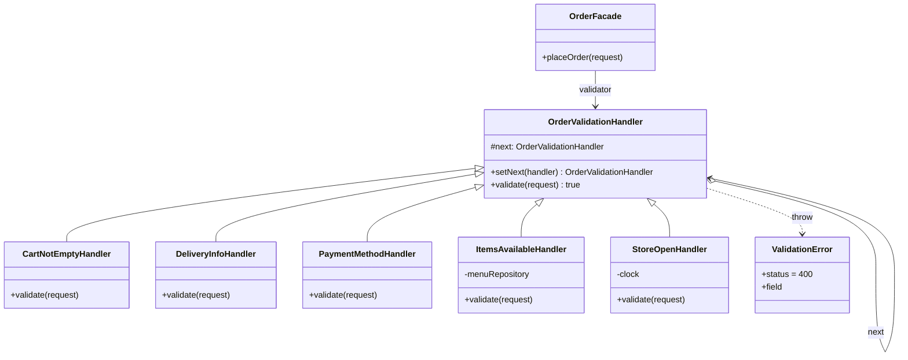
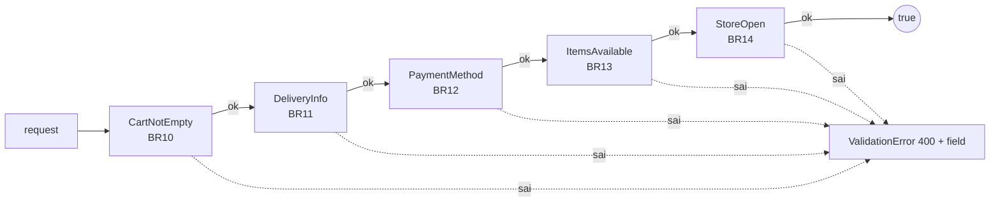

# Chain of Responsibility — Kiểm tra đơn trước khi đặt

**Nhóm:** Behavioral · **Phụ trách:** TV5 · **File:** `server/src/patterns/behavioral/OrderValidation.js` · **Test:** `server/tests/chain.test.js`

## Vấn đề

Trước khi tạo đơn (UC06 bước 3) phải kiểm tra 5 nhóm điều kiện độc lập: giỏ có món (BR10), thông tin giao hàng (BR11), phương thức thanh toán (BR12), món và topping còn bán, số lượng hợp lệ (BR13), cửa hàng đang mở cửa (BR14).

Viết dồn vào một hàm `validateOrder()` dài thì:

- Mỗi lần thêm điều kiện (ví dụ "tối đa 50 ly mỗi đơn") phải sửa hàm đó, dễ làm hỏng điều kiện khác.
- Muốn đổi thứ tự kiểm tra (để báo lỗi dễ hiểu nhất trước) phải cắt dán cả khối `if`.
- Không test riêng từng điều kiện được, và không tái dùng một điều kiện ở chỗ khác.

## Giải pháp

Mỗi điều kiện là một **Handler** riêng. Handler chỉ kiểm tra **một việc**: sai thì `throw new ValidationError(field, message)` và chuỗi dừng ngay; đúng thì gọi `super.validate(request)` để chuyển cho handler kế tiếp. Lớp gốc `OrderValidationHandler` giữ con trỏ `next` và lo việc chuyển tiếp, nên handler con không cần biết ai đứng sau mình.

`buildOrderValidationChain()` nối 5 handler theo thứ tự trong đặc tả. `OrderFacade` (Client) chỉ gọi `chain.validate(request)` một lần, không biết bên trong có bao nhiêu điều kiện.

`field` của lỗi (`customer.phone`, `items[1].toppingIds`...) được `errorHandler` trả về cho frontend để trang Checkout hiện lỗi **dưới đúng ô**.

## Sơ đồ lớp



| Vai trò GoF | Lớp trong dự án |
|---|---|
| Handler | `OrderValidationHandler` (`setNext`, `validate`) |
| ConcreteHandler | `CartNotEmptyHandler`, `DeliveryInfoHandler`, `PaymentMethodHandler`, `ItemsAvailableHandler`, `StoreOpenHandler` |
| Client | `OrderFacade` (nhận chuỗi qua tham số `validator`) |

## Thứ tự chuỗi



| # | Handler | Kiểm tra | `field` khi sai |
|---|---|---|---|
| 1 | `CartNotEmptyHandler` | `items` là mảng có ≥ 1 dòng | `items` |
| 2 | `DeliveryInfoHandler` | họ tên ≥ 2 ký tự, SĐT Việt Nam, địa chỉ ≥ 10 ký tự, ghi chú ≤ 200 ký tự (dùng `utils/validators.js` của B3) | `customer.name` / `customer.phone` / `customer.address` / `customer.note` |
| 3 | `PaymentMethodHandler` | thuộc `config.paymentMethods` | `paymentMethod` |
| 4 | `ItemsAvailableHandler` | món còn bán, mọi topping còn bán, số lượng nguyên 1–20 | `items[i].drinkId` / `items[i].toppingIds` / `items[i].quantity` |
| 5 | `StoreOpenHandler` | giờ Việt Nam trong `[08, 22)` | `store` |

Thứ tự đi từ lỗi khách dễ sửa nhất (giỏ trống, gõ sai SĐT) tới lỗi khách không tự sửa được (cửa hàng đóng cửa). Chuỗi **dừng ở lỗi đầu tiên** nên khách sửa từng lỗi một, đúng như UC06 bước 3.

## Vì sao không dùng một mảng hàm kiểm tra?

`[checkCart, checkInfo, ...].forEach(fn => fn(request))` cũng chạy được, nhưng Chain cho mỗi handler **tự quyết định** có chuyển tiếp hay không. Ví dụ sau này có `VipCustomerHandler` cho khách VIP bỏ qua kiểm tra giờ mở cửa: handler đó chỉ cần không gọi `super.validate()` cho phần sau, các handler khác không đổi. Handler còn mang trạng thái riêng (`ItemsAvailableHandler` giữ `menuRepository`, `StoreOpenHandler` giữ `clock` để test giả giờ), điều mà một hàm rời phải nhận qua tham số chung.

## Ví dụ

```js
const chain = buildOrderValidationChain({ menuRepository, clock: () => 23 });
chain.validate({
  items: [{ drinkId: 'ts-truyen-thong', quantity: 2 }],
  customer: { name: 'Nguyễn An', phone: '0912345678', address: '12 Nguyễn Huệ, Quận 1' },
  paymentMethod: 'COD',
});
// ValidationError { status: 400, field: 'store',
//   message: 'Cửa hàng đang đóng cửa, chỉ nhận đơn từ 08:00 đến 22:00...' }

chain.validate({ items: [], customer: { phone: 'sai' } });
// dừng ở handler đầu tiên: field 'items' (chưa tới bước kiểm tra SĐT)
```

## Nơi dùng trong dự án

- `server/src/services/orderFacadeInstance.js`: tạo chuỗi với `menuRepository` thật, truyền vào `OrderFacade` làm `validator`.
- `POST /api/orders`: lỗi của chuỗi trả `400 { error, field }`; trang `client/src/pages/Checkout.jsx` hiện lỗi dưới ô tương ứng.
- Giờ giả lập cho demo/test (tiêu chí nghiệm thu 7): chạy server với `FAKE_HOUR=23` để thử "cửa hàng đóng cửa".
