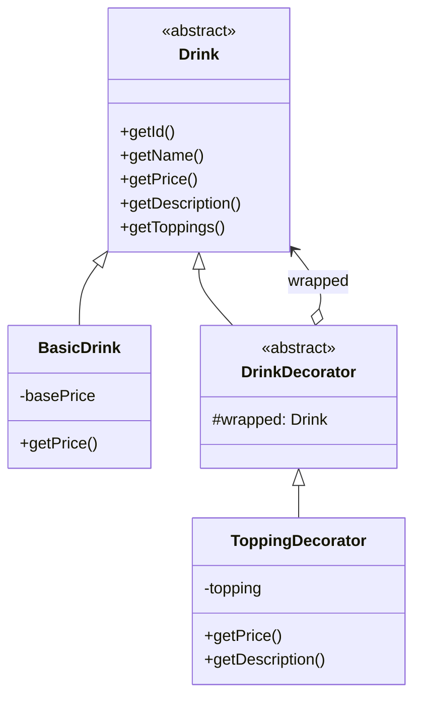

# Decorator — Topping cho đồ uống

**Nhóm:** Structural · **File:** `server/src/patterns/structural/ToppingDecorator.js` · **Test:** `server/tests/decorator.test.js`

## Vấn đề

Một ly trà sữa có thể thêm 0..n topping với mọi tổ hợp. Nếu dùng kế thừa (`TraSuaTranChau`, `TraSuaTranChauPudding`...) số lớp tăng theo cấp số nhân, và mỗi lần thêm topping mới phải viết thêm hàng loạt lớp.

## Giải pháp

Mỗi topping là một lớp vỏ có cùng interface `Drink`, bọc quanh đồ uống bên trong. Vỏ ủy quyền lời gọi vào trong rồi cộng thêm phần của mình, nên có thể bọc nhiều lớp tùy ý.

## Sơ đồ lớp



| Vai trò GoF | Lớp trong dự án |
|---|---|
| Component | `Drink` |
| ConcreteComponent | `BasicDrink` (và `MilkTea`, `FruitTea`... của TV1) |
| Decorator | `DrinkDecorator` |
| ConcreteDecorator | `ToppingDecorator` |

## Vì sao chỉ một ConcreteDecorator?

Topping do admin quản lý trong CSDL. Nếu mỗi topping là một lớp (`PearlDecorator`, `PuddingDecorator`), thêm topping mới phải sửa code và deploy lại. `ToppingDecorator` nhận dữ liệu topping qua constructor nên chỉ cần thêm dữ liệu.

## Ví dụ

```js
let drink = new BasicDrink({ id: 'ts', name: 'Trà sữa', basePrice: 35000 });
drink = new ToppingDecorator(drink, { id: 'tc', name: 'Trân châu', price: 5000 });
drink = new ToppingDecorator(drink, { id: 'pd', name: 'Pudding', price: 7000 });
drink.getPrice();       // 47000
drink.getDescription(); // "Trà sữa + Trân châu + Pudding"
```
