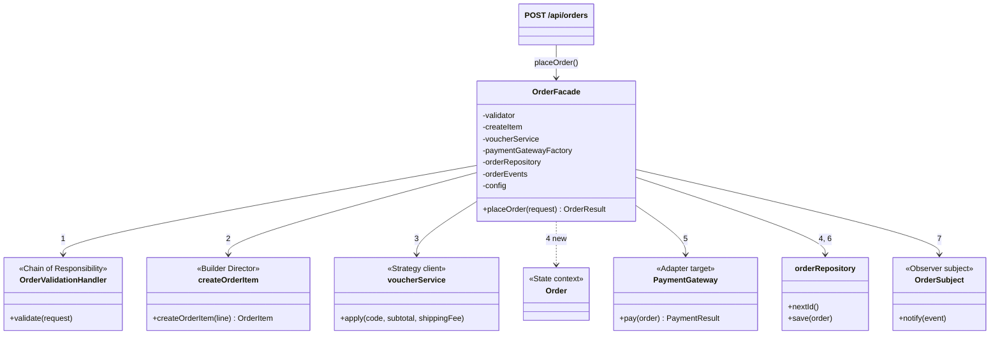
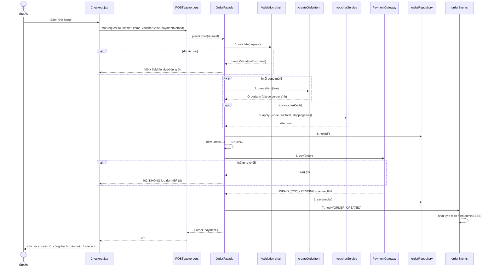

# Facade — Đặt đơn bằng một lời gọi

**Nhóm:** Structural · **Phụ trách:** TV1 · **File:** `server/src/patterns/structural/OrderFacade.js`, `server/src/services/orderFacadeInstance.js` · **Test:** `server/tests/facade.test.js`, `server/tests/place-order.test.js`

## Vấn đề

Đặt một đơn (UC06) phải đi qua **7 hệ thống con**, đúng thứ tự:

1. kiểm tra dữ liệu (Chain of Responsibility),
2. dựng từng dòng món và tính giá ở server (Builder + Factory Method + Decorator),
3. áp mã giảm giá (Strategy),
4. tạo đơn ở trạng thái `PENDING` (State),
5. gọi cổng thanh toán (Adapter),
6. lưu đơn (repository),
7. báo cho trang admin và nhật ký (Observer).

Nếu route `POST /api/orders` tự gọi từng bước thì route dài cả trăm dòng, dễ sai thứ tự (ví dụ lưu đơn **trước** khi cổng thanh toán từ chối, vi phạm BR18), và nơi khác muốn đặt đơn (test nghiệm thu, đặt lại đơn cũ...) lại phải chép nguyên quy trình.

## Giải pháp

`OrderFacade` gom cả quy trình thành **một hàm** `placeOrder(request)`. Facade chỉ **điều phối**: mỗi bước giao cho đúng hệ thống con, không tự tính giảm giá, không tự gọi SDK, không tự kiểm tra số điện thoại.

Các hệ thống con được **truyền vào constructor**, nên:

- `tests/facade.test.js` dùng toàn đồ giả, kiểm tra được thứ tự gọi (`validate → createItem → voucher → pay → save → notify`) mà không cần ai làm xong phần của mình.
- `server/src/services/orderFacadeInstance.js` nối hệ thống con thật một lần; route chỉ còn 1 dòng: `res.status(201).json(await orderFacade.placeOrder(req.body))`.

Lỗi ở bất kỳ bước nào dừng cả quy trình: dữ liệu sai → `400` + `field`, mã giảm giá sai → `404`/`400`, cổng từ chối → `402` và **không lưu đơn**.

## Sơ đồ lớp



| Vai trò GoF | Lớp trong dự án |
|---|---|
| Facade | `OrderFacade` |
| Subsystem classes | `buildOrderValidationChain()` (CoR), `createOrderItem` (Builder + Factory + Decorator), `voucherService` (Strategy), `Order` (State), `createPaymentGateway` (Adapter), `orderRepository`, `orderEvents` (Observer) |
| Client | route `POST /api/orders` (`server/src/routes/order.routes.js`) |

## Sơ đồ tuần tự (DAC_TA mục 7.3)



## Vì sao Facade, không phải một "service" bình thường?

Facade **là** một lớp dịch vụ, điểm khác là mục đích: nó không thêm nghiệp vụ mới mà chỉ đưa ra **một cửa đơn giản** cho một tập hệ thống con phức tạp. Các hệ thống con vẫn dùng được trực tiếp khi cần (ví dụ `POST /cart/price` gọi thẳng `createOrderItem`, `POST /vouchers/validate` gọi thẳng `voucherService`). Facade không che giấu hay khóa chúng lại; nó chỉ giúp nơi muốn "đặt một đơn" không phải biết 7 bước.

Facade cũng là chỗ **các pattern khác gặp nhau**: đọc `placeOrder()` là thấy 6 pattern còn lại của nhóm làm việc cùng nhau theo đúng UC06.

## Ví dụ

```js
const { order, payment } = await orderFacade.placeOrder({
  customer: { name: 'Nguyễn An', phone: '0912345678', address: '12 Nguyễn Huệ, Quận 1', note: '' },
  items: [{ drinkId: 'ts-truyen-thong', size: 'L', sugar: 50, ice: 70, toppingIds: ['tran-chau-den'], quantity: 2 }],
  voucherCode: 'MAY10',
  paymentMethod: 'MOMO',
});
order.subtotal;        // 92000  (46.000đ × 2, BR02)
order.discount;        // 9200   (MAY10: 10%)
order.total;           // 97800  (92.000 + 15.000 − 9.200, BR09)
order.paymentStatus;   // 'PENDING'
payment.redirectUrl;   // '/payment/mock?gateway=momo&orderId=DH004&amount=97800&...'
```

## Nơi dùng trong dự án

- `POST /api/orders` (`server/src/routes/order.routes.js`).
- `client/src/pages/Checkout.jsx`: form kiểm tra sớm bằng `client/src/utils/validators.js` (cùng quy tắc với server), chọn phương thức (`PaymentMethodPicker`), áp lại mã giảm giá của giỏ; gửi **một** request; lỗi có `field` hiện dưới ô; thành công thì xóa giỏ, chuyển sang cổng thanh toán hoặc `/orders/:id`.
- Giờ giả lập cho demo tiêu chí 7: `FAKE_HOUR=23 npm run dev` (PowerShell: `$env:FAKE_HOUR=23; npm run dev`) → đặt hàng báo "Cửa hàng đang đóng cửa".
