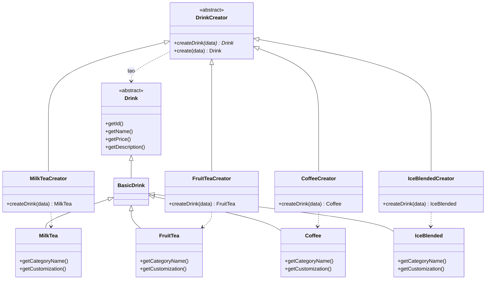

# Factory Method — Tạo đúng loại đồ uống

**Nhóm:** Creational · **Phụ trách:** TV1 · **File:** `server/src/patterns/creational/DrinkFactory.js`, `server/src/domain/drinks/*.js` · **Test:** `server/tests/factory.test.js`, `server/tests/drinks.test.js`

## Vấn đề

Menu có 4 loại đồ uống, mỗi loại có quy tắc riêng:

| Loại | Thêm topping | Chỉnh đường | Chỉnh đá |
|---|---|---|---|
| Trà sữa | Có | Có | Có |
| Trà trái cây | Có | Có | Có |
| Cà phê | **Không** | Có | Có |
| Đá xay | Có | Có | **Không** |

Nếu route `/api/drinks` hay dịch vụ tính giá tự `new` đối tượng thì mỗi nơi phải tự biết "`ca-phe` thì tạo `Coffee`, `da-xay` thì tạo `IceBlended`". Kiến thức này bị chép ra nhiều chỗ, và mỗi lần thêm loại mới (ví dụ "Sữa chua") phải sửa từng chỗ đó.

## Giải pháp

Tách việc "tạo lớp nào" ra khỏi nơi dùng:

- Mỗi loại đồ uống là một **ConcreteProduct** (`MilkTea`, `FruitTea`, `Coffee`, `IceBlended`), tự khai báo tên danh mục `getCategoryName()` và quy tắc tùy chỉnh `getCustomization()`.
- Mỗi loại có một **ConcreteCreator** override factory method `createDrink()` để tạo đúng lớp của mình.
- **Creator** `DrinkCreator` giữ phần dùng chung trong `create()`: kiểm tra dữ liệu vào, gọi `createDrink()`, bảo đảm kết quả là một `Drink`. Creator gốc không tự tạo được gì, gọi `createDrink()` trên nó sẽ báo lỗi.
- Nơi dùng chỉ gọi `createDrinkFromData(data)`. Hàm này tra bảng `categoryId → Creator` rồi gọi `create()`, nên không cần biết tới `MilkTea` hay `Coffee`.

## Sơ đồ lớp



| Vai trò GoF | Lớp trong dự án |
|---|---|
| Product | `Drink` (`server/src/domain/Drink.js`) |
| ConcreteProduct | `MilkTea`, `FruitTea`, `Coffee`, `IceBlended` (`server/src/domain/drinks/`) |
| Creator | `DrinkCreator` (factory method `createDrink()`, thao tác `create()`) |
| ConcreteCreator | `MilkTeaCreator`, `FruitTeaCreator`, `CoffeeCreator`, `IceBlendedCreator` |
| Client | route `GET /api/drinks`, `GET /api/drinks/:id`; dịch vụ dựng dòng món (Builder, TV3) |

## Vì sao không dùng một hàm `switch`?

```js
// Simple Factory — KHÔNG phải Factory Method của GoF
function createDrink(data) {
  switch (data.categoryId) {
    case 'tra-sua': return new MilkTea(data);
    case 'ca-phe': return new Coffee(data);
    // ...
  }
}
```

Hàm `switch` gom mọi quyết định vào một chỗ: thêm loại mới phải mở hàm ra sửa. Với Factory Method, **lớp con quyết định** tạo lớp nào: thêm loại "Sữa chua" chỉ cần thêm `Yogurt` + `YogurtCreator` và một dòng đăng ký trong bảng `creators`. `DrinkCreator.create()` và mọi nơi gọi `createDrinkFromData()` giữ nguyên. Test `factory.test.js` kiểm tra điều này: sản phẩm là lớp con riêng (không phải `BasicDrink`), và `new DrinkCreator().createDrink()` phải báo lỗi.

## Quy tắc của từng loại được dùng ở đâu?

`getCustomization()` không chỉ để hiển thị:

1. `GET /api/drinks/:id` trả `categoryName` và `customization`. Form tùy chỉnh món (TV3) dựa vào đó để ẩn phần topping của cà phê và phần mức đá của đá xay.
2. `OrderItemBuilder.build()` (Task 3, TV3) đọc lại quy tắc từ chính đối tượng `Drink`. Gửi topping cho cà phê thì bị từ chối (400), kể cả khi ai đó gọi thẳng API mà không qua giao diện.

## Ví dụ

```js
const drink = createDrinkFromData({ id: 'cf-muoi', categoryId: 'ca-phe', name: 'Cà phê muối', basePrice: 35000 });
drink.constructor.name;      // 'Coffee'
drink.getCategoryName();     // 'Cà phê'
drink.getCustomization();    // { allowToppings: false, allowSugar: true, allowIce: true }
drink instanceof Drink;      // true — vẫn bọc topping bằng Decorator được như mọi Drink

createDrinkFromData({ categoryId: 'banh-mi' }); // Error: Không hỗ trợ loại đồ uống: banh-mi
new DrinkCreator().createDrink(data);         // Error: DrinkCreator phải override createDrink()
```

`GET /api/drinks/cf-muoi`:

```json
{
  "id": "cf-muoi", "categoryId": "ca-phe", "name": "Cà phê muối", "basePrice": 35000,
  "description": "Cà phê đậm, lớp kem muối béo mặn nhẹ.", "image": "/images/drinks/cf-muoi.svg",
  "isBestSeller": false, "isActive": true,
  "categoryName": "Cà phê",
  "customization": { "allowToppings": false, "allowSugar": true, "allowIce": true }
}
```

## Nơi dùng trong dự án

- `server/src/routes/menu.routes.js`: `GET /api/drinks` và `GET /api/drinks/:id` tạo đối tượng qua `createDrinkFromData()`, trả thêm `categoryName`, `customization`, giữ nguyên các trường cũ.
- `POST /api/cart/price` (TV3) và `OrderFacade.placeOrder()` (Sprint 2): dựng món từ dữ liệu gốc qua `createDrinkFromData()` rồi giao cho Builder.
