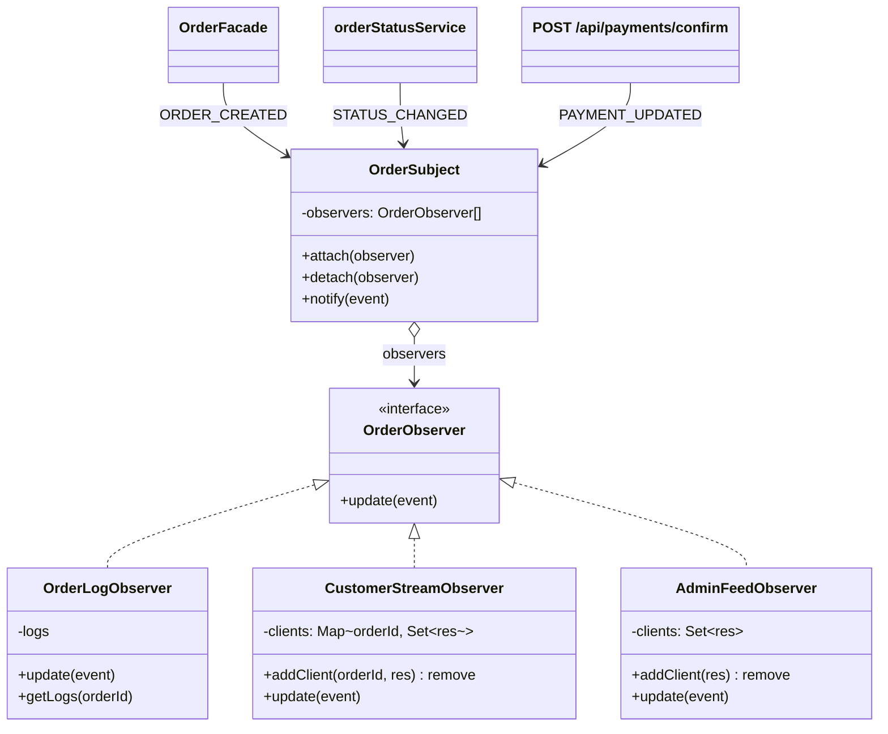
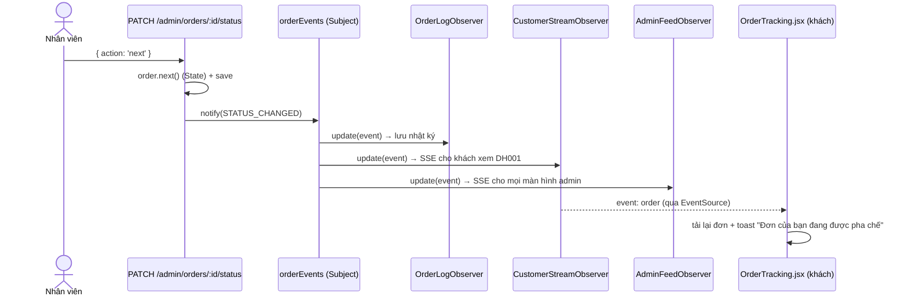

# Observer — Cập nhật đơn hàng theo thời gian thực

**Nhóm:** Behavioral · **Phụ trách:** TV2 · **File:** `server/src/patterns/behavioral/OrderEvents.js`, `server/src/events.js` · **Test:** `server/tests/observer.test.js`, `server/tests/events.test.js`

## Vấn đề

Khi một đơn được tạo, đổi trạng thái hoặc cổng thanh toán báo về, có **nhiều nơi** cần biết:

- trang theo dõi đơn của khách (`/orders/:id`) phải tự chuyển "Đang pha chế" (UC08),
- màn hình admin phải hiện đơn mới ngay (UC10),
- nhật ký hệ thống ghi lại mọi sự kiện.

Nếu code đổi trạng thái tự gọi từng nơi (`pushToCustomer(); pushToAdmin(); writeLog();`) thì route khách, route admin, `OrderFacade`, route thanh toán đều phải biết hết các nơi nhận. Thêm một nơi nhận mới (ví dụ gửi SMS) là phải sửa 4 chỗ phát sự kiện.

## Giải pháp

Nơi phát sinh sự kiện chỉ giữ một **Subject** (`orderEvents`) và gọi `notify(event)`. Ai quan tâm thì tự **đăng ký** (`attach`) làm Observer với cùng một hàm `update(event)`. Subject không biết observer làm gì bên trong:

- `OrderLogObserver` lưu sự kiện vào bộ nhớ (`getLogs(orderId?)`).
- `CustomerStreamObserver` giữ các kết nối SSE theo `orderId`, chỉ đẩy sự kiện cho khách đang xem **đúng đơn đó**.
- `AdminFeedObserver` đẩy **mọi** sự kiện cho các màn hình admin đang mở.

Một observer lỗi (ví dụ kết nối đã đóng) chỉ bị ghi `console.error`; các observer khác vẫn nhận sự kiện. Ba observer được đăng ký một lần trong `server/src/events.js`.

Sự kiện đi tới trình duyệt bằng **Server-Sent Events** (`GET /api/orders/:id/events`, `GET /api/admin/events`). Phía client, hook `useOrderEvents(url, onEvent)` mở `EventSource`, nghe sự kiện tên `order` và gọi `onEvent`: đây là "observer phía trình duyệt" của cùng một luồng.

## Sơ đồ lớp



| Vai trò GoF | Lớp trong dự án |
|---|---|
| Subject | `OrderSubject` (instance dùng chung `orderEvents` trong `events.js`) |
| Observer | `OrderObserver` (`update(event)`) |
| ConcreteObserver | `OrderLogObserver`, `CustomerStreamObserver`, `AdminFeedObserver` |
| Nơi phát sự kiện | `OrderFacade` (`ORDER_CREATED`), `orderStatusService.changeOrderStatus` (`STATUS_CHANGED`, dùng cho cả route khách và admin), route `POST /payments/confirm` (`PAYMENT_UPDATED`) |

## Sơ đồ tuần tự: nhân viên xác nhận đơn



## Định dạng sự kiện

```
event: order
data: {"type":"STATUS_CHANGED","orderId":"DH001","status":"PREPARING","paymentStatus":"UNPAID","from":"PENDING","to":"PREPARING","at":"2026-10-12T05:03:16.641Z"}

```

`type` ∈ `ORDER_CREATED` | `STATUS_CHANGED` | `PAYMENT_UPDATED`. Server gửi `: ping` mỗi 25 giây để giữ kết nối, gỡ client khi trình duyệt đóng (`req.on('close')`). Hàm `orderEvent(type, order, extra)` trong `events.js` dựng sự kiện đúng định dạng.

## Vì sao không dùng `EventEmitter` của Node?

`EventEmitter` cũng là một dạng Observer, nhưng: (1) observer chỉ là hàm rời, không có lớp để test riêng và mang trạng thái (danh sách kết nối SSE); (2) một listener ném lỗi sẽ làm `emit()` ném lỗi theo, đơn đã lưu nhưng request trả 500. `OrderSubject` tự cài nên bắt lỗi từng observer, đúng hợp đồng "một observer lỗi không làm hỏng observer khác", và thể hiện rõ các vai trò GoF.

## Ví dụ

```js
import { orderEvents, orderEvent } from './events.js';

// Nơi phát: không biết ai đang nghe
orderEvents.notify(orderEvent('STATUS_CHANGED', order, { from: 'PENDING', to: 'PREPARING' }));

// Thêm nơi nhận mới: không sửa nơi phát
class SmsObserver extends OrderObserver {
  update(event) {
    if (event.type === 'STATUS_CHANGED' && event.to === 'DELIVERING') sendSms(event.orderId);
  }
}
orderEvents.attach(new SmsObserver());
```

```jsx
// Trình duyệt (OrderTracking.jsx)
const { connected } = useOrderEvents(apiUrl(`/orders/${id}/events`), (event) => {
  load();                                       // tải lại đơn
  toast.show('Đơn của bạn đang được pha chế');  // components/Toast.jsx
});
```

## Nơi dùng trong dự án

- `client/src/pages/OrderTracking.jsx`: tự cập nhật thanh tiến trình, trạng thái thanh toán, hiện "Tự cập nhật" / "Đang kết nối lại...".
- `client/src/pages/admin/AdminLayout.jsx`: toast "Có đơn mới DH005" ở mọi trang admin; `AdminOrders.jsx` thêm đơn mới vào đầu bảng.
- `client/src/components/Toast.jsx` + `client/src/hooks/useToast.js`: thông báo nổi dùng chung.
