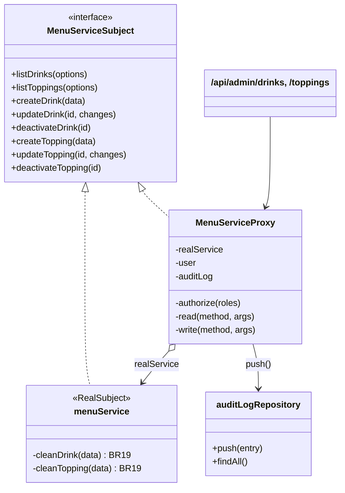
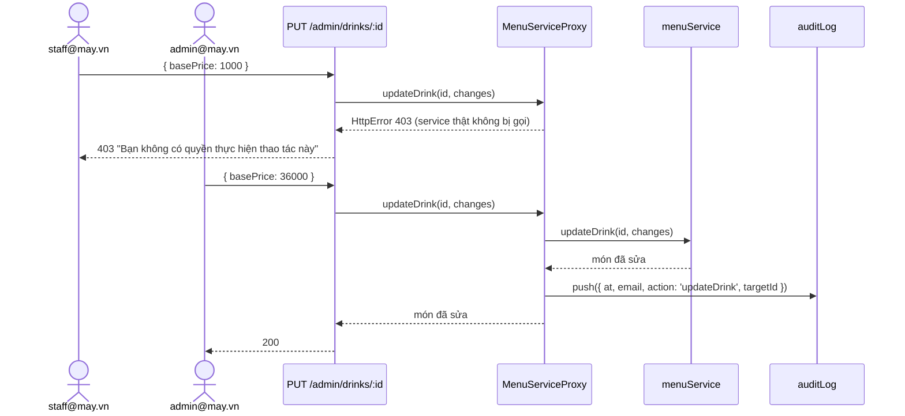

# Proxy — Phân quyền và nhật ký cho quản lý menu

**Nhóm:** Structural · **Phụ trách:** TV4 · **File:** `server/src/patterns/structural/MenuServiceProxy.js`, `server/src/services/menuService.js` · **Test:** `server/tests/proxy.test.js`, `server/tests/admin-menu.test.js`, `server/tests/auth.test.js`

## Vấn đề

Trang `/admin/menu` cho phép thêm, sửa, ngừng bán món và topping (UC11). Quy tắc:

- Nhân viên (`staff`) chỉ được **xem**; chỉ quản trị (`admin`) được **sửa** (BR20).
- Mọi thao tác sửa phải **ghi nhật ký**: thời điểm, email, hành động, mã đối tượng; thao tác xem không ghi (BR22).

Nếu nhét kiểm tra quyền và ghi log vào `MenuService`, lớp này vừa lo nghiệp vụ (kiểm tra giá, danh mục, ngừng bán) vừa lo bảo mật; mỗi hàm mới lại phải nhớ chép đoạn `if (user.role !== 'admin')` và `auditLog.push(...)`. Quên một chỗ là nhân viên sửa được giá mà không ai biết.

## Giải pháp

`MenuServiceProxy` có **cùng 8 hàm** như `MenuService` thật và đứng chắn phía trước:

1. **Kiểm tra quyền** (Protection Proxy): chưa đăng nhập → `401`; hàm ghi mà không phải admin → `403`. Sai quyền thì **service thật không bao giờ bị gọi**.
2. **Gọi service thật** và trả về đúng kết quả của nó.
3. **Ghi nhật ký** (Logging Proxy) sau khi hàm ghi thành công. Service thật báo lỗi (404, 400) thì lỗi được ném tiếp và **không ghi** nhật ký.

`MenuService` (RealSubject) chỉ còn nghiệp vụ thuần: kiểm tra dữ liệu BR19, ngừng bán thay cho xóa (BR23). Route admin luôn tạo `new MenuServiceProxy(menuService, req.user, auditLogRepository)` cho mỗi request, không bao giờ gọi thẳng `menuService`. Vì Proxy và service thật cùng interface, route không biết mình đang nói chuyện với Proxy.

Middleware `requireAuth` chỉ xác định **ai** đang gọi (token → `req.user`); quyết định **được làm gì** với menu thuộc về Proxy, nên route menu dùng `requireAuth('admin', 'staff')` cho cả đọc lẫn ghi.

## Sơ đồ lớp



| Vai trò GoF | Lớp trong dự án |
|---|---|
| Subject | 8 hàm trong `MENU_SERVICE_METHODS` (`READ_METHODS` + `WRITE_METHODS`) |
| RealSubject | `menuService` (`server/src/services/menuService.js`) |
| Proxy | `MenuServiceProxy` (Protection Proxy + Logging Proxy) |
| Client | route `/api/admin/drinks`, `/api/admin/toppings` (`server/src/routes/admin.routes.js`) |

## Sơ đồ tuần tự: nhân viên và admin sửa giá



## Bảng quyền

| Hàm | Loại | admin | staff | chưa đăng nhập |
|---|---|---|---|---|
| `listDrinks`, `listToppings` | đọc | ✅ | ✅ | 401 |
| `createDrink`, `updateDrink`, `deactivateDrink` | ghi + nhật ký | ✅ | 403 | 401 |
| `createTopping`, `updateTopping`, `deactivateTopping` | ghi + nhật ký | ✅ | 403 | 401 |

## Vì sao không chỉ dùng middleware `requireAuth('admin')` cho route ghi?

Middleware cũng chặn được, nhưng quy tắc quyền khi đó nằm rải rác ở từng dòng khai báo route, và **ghi nhật ký** vẫn phải viết trong từng handler. Proxy gom cả hai việc vào một chỗ, áp cho **mọi** nơi dùng menu service (route hôm nay, script nhập menu hay trang khác sau này), và test được không cần HTTP (`tests/proxy.test.js` dùng service giả). Thêm hàm mới vào menu service = thêm tên vào `READ_METHODS`/`WRITE_METHODS` và một hàm một dòng trong Proxy.

## Ví dụ

```js
const auditLog = [];
const asStaff = new MenuServiceProxy(menuService, { email: 'staff@may.vn', role: 'staff' }, auditLog);
await asStaff.listDrinks();                                   // được xem
await asStaff.updateDrink('ts-truyen-thong', { basePrice: 1 }); // HttpError 403, giá không đổi

const asAdmin = new MenuServiceProxy(menuService, { email: 'admin@may.vn', role: 'admin' }, auditLog);
await asAdmin.updateDrink('ts-truyen-thong', { basePrice: 36000 });
auditLog; // [{ at: '...', email: 'admin@may.vn', action: 'updateDrink', targetId: 'ts-truyen-thong' }]
```

## Nơi dùng trong dự án

- Đăng nhập: `authService` (token ngẫu nhiên 32 byte, phiên 8 giờ, mật khẩu scrypt, BR21) + `middlewares/auth.js` (thay hẳn bản tạm, đọc `Authorization: Bearer`, riêng luồng SSE nhận `?token=`).
- API: `POST /api/admin/login`, `/logout`, `GET /me`, CRUD `/api/admin/drinks`, `/api/admin/toppings`, `GET /api/admin/audit-log` (chỉ admin).
- Giao diện: `client/src/pages/admin/AdminLogin.jsx`, `AdminLayout.jsx` (chặn khi chưa đăng nhập, hết phiên quay về trang đăng nhập), `AdminMenu.jsx` (tab Món / Topping / Nhật ký; nhân viên không thấy tab Nhật ký, bấm sửa thì nhận 403 từ Proxy).
