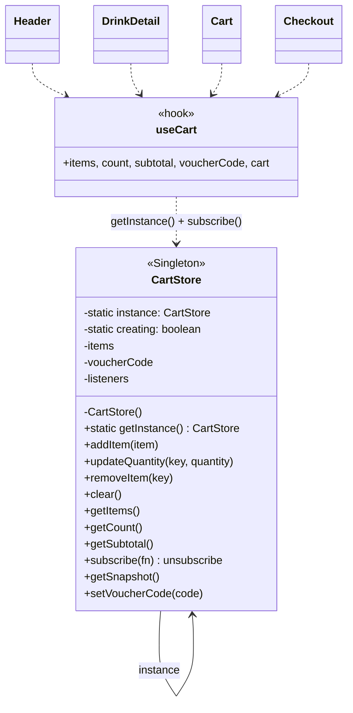

# Singleton — Giỏ hàng dùng chung

**Nhóm:** Creational · **Phụ trách:** TV2 · **File:** `client/src/store/cartStore.js`, `client/src/store/useCart.js` · **Test:** `client/tests/cartStore.test.js`, `client/tests/cartStorage.test.js`

## Vấn đề

Nhiều nơi trên giao diện cùng làm việc với giỏ hàng:

- Header hiện số ly trên biểu tượng giỏ.
- Trang Chi tiết món bấm "Thêm vào giỏ".
- Trang Giỏ hàng tăng/giảm số lượng, áp mã giảm giá.
- Trang Đặt hàng đọc giỏ để gửi đơn, xong thì xóa giỏ.

Nếu mỗi nơi tự `new` một giỏ, mỗi giỏ có dữ liệu riêng: thêm món ở trang chi tiết nhưng Header vẫn hiện 0, trang Đặt hàng gửi giỏ rỗng.

## Giải pháp

`CartStore` chỉ có **một instance duy nhất**, lấy qua `CartStore.getInstance()`:

- `static #instance` giữ instance, lần đầu gọi `getInstance()` mới tạo.
- Constructor bị khóa bằng cờ riêng tư `static #creating`. Gọi `new CartStore()` từ bên ngoài sẽ báo lỗi, nên không ai vô tình tạo giỏ thứ hai.
- Giỏ báo cho các nơi đang dùng qua `subscribe()`. Hook `useCart()` nối `subscribe()` với `useSyncExternalStore` của React, nên Header và các trang tự vẽ lại khi giỏ đổi.
- Mỗi thay đổi được lưu vào `localStorage` (key `may-cart`, bọc `try/catch`), nên tải lại trang giỏ vẫn còn (BR05).

## Sơ đồ lớp



| Vai trò GoF | Trong dự án |
|---|---|
| Singleton | `CartStore` (`static #instance`, `static getInstance()`, constructor bị khóa) |
| Client | `Layout` (Header), `DrinkDetail`, `Cart`, `Checkout` qua `useCart()` |

## Vì sao không dùng React Context?

React Context cũng chia sẻ được dữ liệu, nhưng giỏ hàng là logic thuần (gộp dòng trùng `key`, giới hạn 20 ly, lưu `localStorage`), cần test được bằng `node --test` mà không dựng React. Singleton tách logic ra khỏi React: test gọi thẳng `CartStore.getInstance()`, còn React chỉ là một "người đăng ký" qua `useSyncExternalStore`.

`getSnapshot()` trả về một đối tượng **bất biến, chỉ đổi khi giỏ đổi**. `useSyncExternalStore` yêu cầu như vậy, nếu không React sẽ vẽ lại liên tục.

## Ví dụ

```js
const cart = CartStore.getInstance();
cart.addItem({ key: 'ts|L|50|70|pudding|', drinkId: 'ts-truyen-thong', unitPrice: 48000, quantity: 1 });
cart.addItem({ key: 'ts|L|50|70|pudding|', drinkId: 'ts-truyen-thong', unitPrice: 48000, quantity: 1 });
CartStore.getInstance().getCount(); // 2 — cùng key nên gộp một dòng (BR05)
CartStore.getInstance() === cart;  // true
new CartStore();                   // Error: CartStore là Singleton...
```

```jsx
function Header() {
  const { count } = useCart(); // tự cập nhật khi trang khác thêm món
  return <span className="badge">{count}</span>;
}
```
