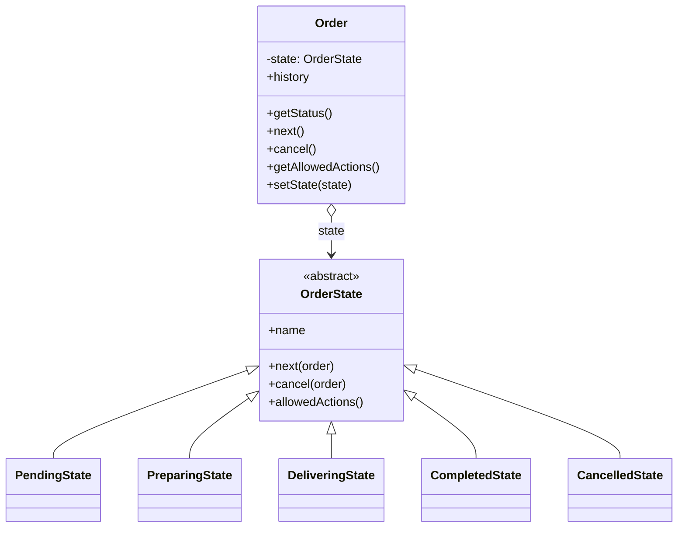
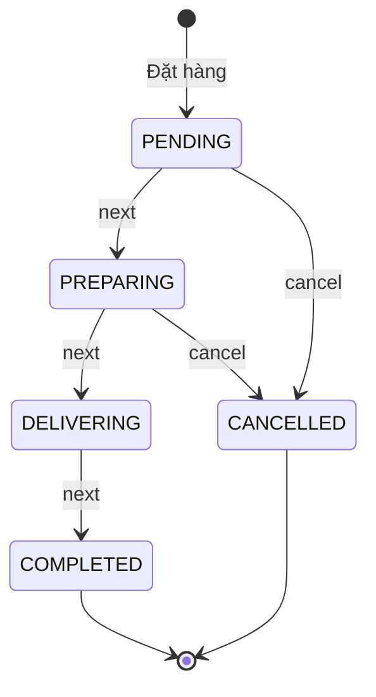

# State — Vòng đời đơn hàng

**Nhóm:** Behavioral · **Phụ trách:** TV5 · **File:** `server/src/patterns/behavioral/OrderState.js` · **Test:** `server/tests/state.test.js`, `server/tests/order.test.js`

## Vấn đề

Đơn hàng đi qua `PENDING → PREPARING → DELIVERING → COMPLETED`, có thể bị `CANCELLED` (BR15). Mỗi trạng thái cho phép thao tác khác nhau: hủy được khi chờ xác nhận hoặc đang pha chế, nhưng không hủy được khi đang giao. Nếu viết `if (status === 'PENDING') ... else if (status === 'PREPARING') ...` ở route khách, route admin và luồng thanh toán, quy tắc bị chép ra nhiều nơi. Chỉ cần sửa sót một chỗ là cho phép hủy đơn đang giao.

## Giải pháp

Mỗi trạng thái là một lớp **ConcreteState** cài các thao tác nó cho phép (`next`, `cancel`) và tự quyết định trạng thái kế tiếp bằng `order.setState(new ...State())`. `Order` (Context) không chứa `if` nào về trạng thái, chỉ ủy quyền cho state hiện tại.

Lớp gốc `OrderState` mặc định **từ chối mọi thao tác** (ném `InvalidTransitionError`, route trả 409). Mỗi lớp con chỉ override thao tác được phép, nên hai trạng thái cuối `CompletedState`, `CancelledState` gần như rỗng. Mỗi lần chuyển, `Order.setState()` ghi lịch sử `{ from, to, at }`.

## Sơ đồ lớp



| Vai trò GoF | Lớp trong dự án |
|---|---|
| Context | `Order` |
| State | `OrderState` |
| ConcreteState | `PendingState`, `PreparingState`, `DeliveringState`, `CompletedState`, `CancelledState` |

## Sơ đồ trạng thái



| State | `next()` | `cancel()` | `allowedActions()` |
|---|---|---|---|
| `PendingState` | → `PREPARING` | → `CANCELLED` | `['next', 'cancel']` |
| `PreparingState` | → `DELIVERING` | → `CANCELLED` | `['next', 'cancel']` |
| `DeliveringState` | → `COMPLETED` | 409 | `['next']` |
| `CompletedState` | 409 | 409 | `[]` |
| `CancelledState` | 409 | 409 | `[]` |

## Vì sao không dùng một bảng chuyển trạng thái?

Một bảng `{ PENDING: { next: 'PREPARING', ... } }` cũng chạy được, nhưng mọi hành vi phải nằm trong một hàm chung đọc bảng. State cho phép mỗi trạng thái có **hành vi riêng** khi cần, ví dụ sau này `DeliveringState.next()` có thể yêu cầu ảnh xác nhận giao hàng mà không ảnh hưởng trạng thái khác. Route chỉ gọi `order[action]()` và để State quyết định.

## Ví dụ

```js
const order = new Order({ id: 'DH001', customerName: 'An', total: 47000 });
order.getStatus();         // 'PENDING'
order.next();              // PREPARING
order.getAllowedActions(); // ['next', 'cancel']
order.next();              // DELIVERING
order.cancel();            // InvalidTransitionError (409): Không thể hủy đơn khi đơn đang ở trạng thái "Đang giao"
order.history;             // [{ from: 'PENDING', to: 'PREPARING', at }, { from: 'PREPARING', to: 'DELIVERING', at }]
```

## Nơi dùng trong dự án

- `GET/PATCH /api/orders/:id` (`server/src/routes/order.routes.js`) và trang `client/src/pages/OrderTracking.jsx`.
- `orderRepository` lưu đơn trong bộ nhớ, seed DH001 (PENDING), DH002 (DELIVERING), DH003 (CANCELLED).
- Sprint 2: trang quản lý đơn của admin, luồng thanh toán (khách hủy → `order.cancel()`), OrderFacade tạo đơn ở `PENDING`.
