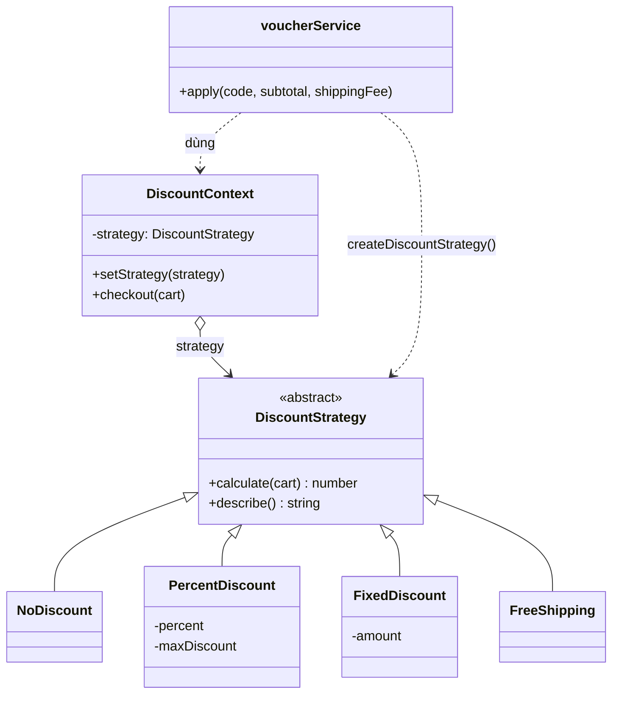
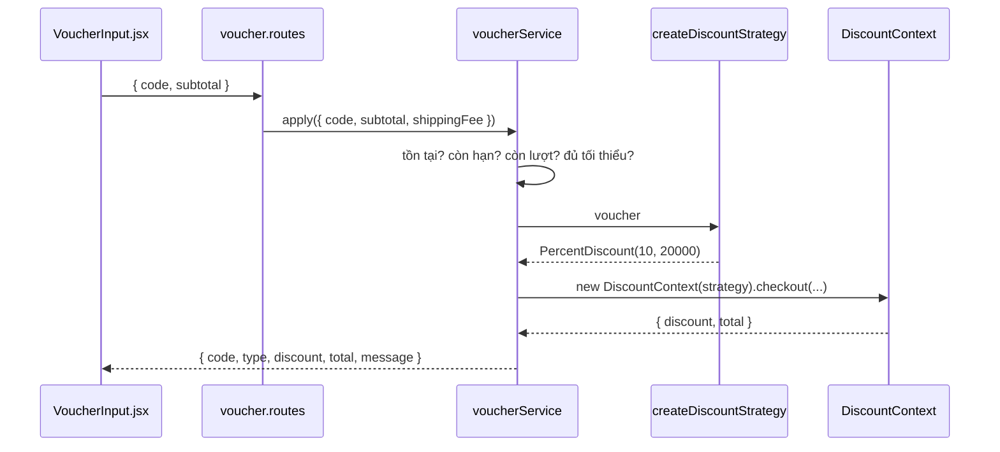

# Strategy — Các kiểu mã giảm giá

**Nhóm:** Behavioral · **Phụ trách:** TV4 · **File:** `server/src/patterns/behavioral/DiscountStrategy.js` · **Test:** `server/tests/strategy.test.js`, `server/tests/voucher.test.js`

## Vấn đề

Cửa hàng có nhiều kiểu khuyến mãi: giảm theo %, có trần (`MAY10`), giảm số tiền cố định (`GIAM20K`), miễn phí giao hàng (`FREESHIP`). Nếu giỏ hàng tự tính bằng `if (type === 'percent') ... else if (type === 'fixed') ...`, mỗi lần thêm kiểu khuyến mãi mới (ví dụ "mua 2 tặng 1") phải sửa code giỏ hàng và checkout, rất dễ làm sai các kiểu cũ.

## Giải pháp

Mỗi cách tính là một lớp **ConcreteStrategy** có cùng interface `calculate({ subtotal, shippingFee })`. `DiscountContext` chỉ giữ một strategy và gọi `calculate()`, không cần biết đó là kiểu gì. Khi khách nhập mã khác, strategy được đổi lúc chạy bằng `setStrategy()`.

Quy tắc chung của BR08 (không âm, không vượt tạm tính + phí ship) nằm trong hàm `limitDiscount()`. Mọi strategy đều đi qua hàm này nên quy tắc chỉ viết một lần.

## Sơ đồ lớp



| Vai trò GoF | Lớp trong dự án |
|---|---|
| Strategy | `DiscountStrategy` |
| ConcreteStrategy | `NoDiscount`, `PercentDiscount`, `FixedDiscount`, `FreeShipping` |
| Context | `DiscountContext` |
| Client | `voucherService` (`server/src/services/voucherService.js`) |

## Vì sao kiểm tra điều kiện mã nằm ngoài Strategy?

"Mã còn hạn không, còn lượt không, đơn đủ tối thiểu chưa" (BR07) giống nhau với mọi kiểu khuyến mãi. Nếu đặt trong từng strategy thì phải chép lại 4 lần. `voucherService` kiểm tra điều kiện trước, xong mới chọn strategy bằng `createDiscountStrategy(voucher)` và giao việc tính tiền. Mỗi lớp chỉ làm một việc.

`createDiscountStrategy()` dùng bảng `STRATEGY_BY_TYPE` (loại voucher → hàm tạo strategy). Thêm kiểu mới chỉ cần thêm một lớp và một dòng trong bảng.

## Luồng xử lý `POST /api/vouchers/validate`



## Ví dụ

```js
const context = new DiscountContext(); // NoDiscount
context.checkout({ subtotal: 100000, shippingFee: 15000 }).total; // 115000

context.setStrategy(new PercentDiscount(10, 20000));
context.checkout({ subtotal: 100000, shippingFee: 15000 }); // discount 10000, total 105000

context.setStrategy(new FreeShipping());
context.checkout({ subtotal: 100000, shippingFee: 15000 }).total; // 100000
```

## Nơi dùng trong dự án

- `POST /api/vouchers/validate`: ô nhập mã ở trang Giỏ hàng (`client/src/components/VoucherInput.jsx`).
- `OrderFacade.placeOrder()` (Sprint 2): bước 3 gọi `voucherService.apply()` để tính lại giảm giá ở server.
